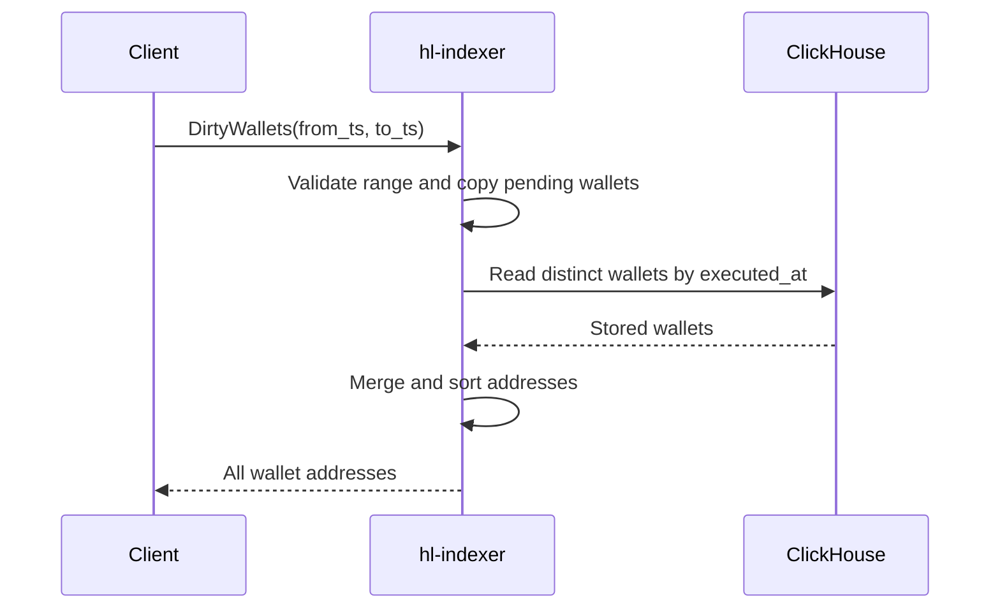

# Dirty wallet endpoint

Plan: [[dirty-wallet-history-endpoint-todo]]

`HyperCore.DirtyWallets` returns stored dirty wallets in `[from_ts, to_ts)` plus all currently pending wallets.
It is available only on native gRPC. The existing internal-method list blocks public gRPC-web access.

| Field | Meaning or source |
| --- | --- |
| Request `from_ts` | Positive inclusive Unix timestamp for the first execution-minute bucket |
| Request `to_ts` | Exclusive Unix timestamp. Zero selects request time |
| Response `wallet_addresses` | Unique sorted addresses from ClickHouse and pending memory |

> [!info]
> Use execution-minute buckets and seven-day retention. Return one response without pagination or truncation.
> Read pending memory before ClickHouse. Pending wallets also appear in historical queries.
> Reads do not clear history or pending memory. Return no cursor or completion metadata.

Invalid ranges return `InvalidArgument`. Expired starts return `OutOfRange`. Database failures return `Unavailable`.
Canceled queries and expired deadlines retain their respective gRPC status codes.

> [!note]
> Late backfill can add wallets to past buckets. An empty result does not certify complete ingestion.
> A query can omit the batch during its source/history flush. This limit was accepted.

70,000 addresses of 42 bytes use 3,080,000 protobuf bytes. The response has no explicit result cap.
The generated bindings, query, handler, and permanent local tests are complete.
Deployment and unrelated messages are outside this change.
