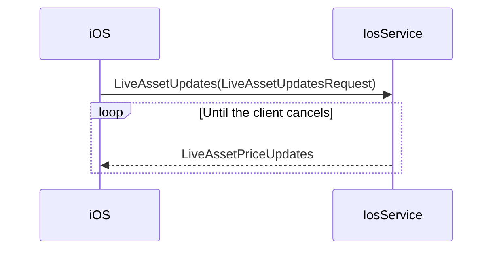
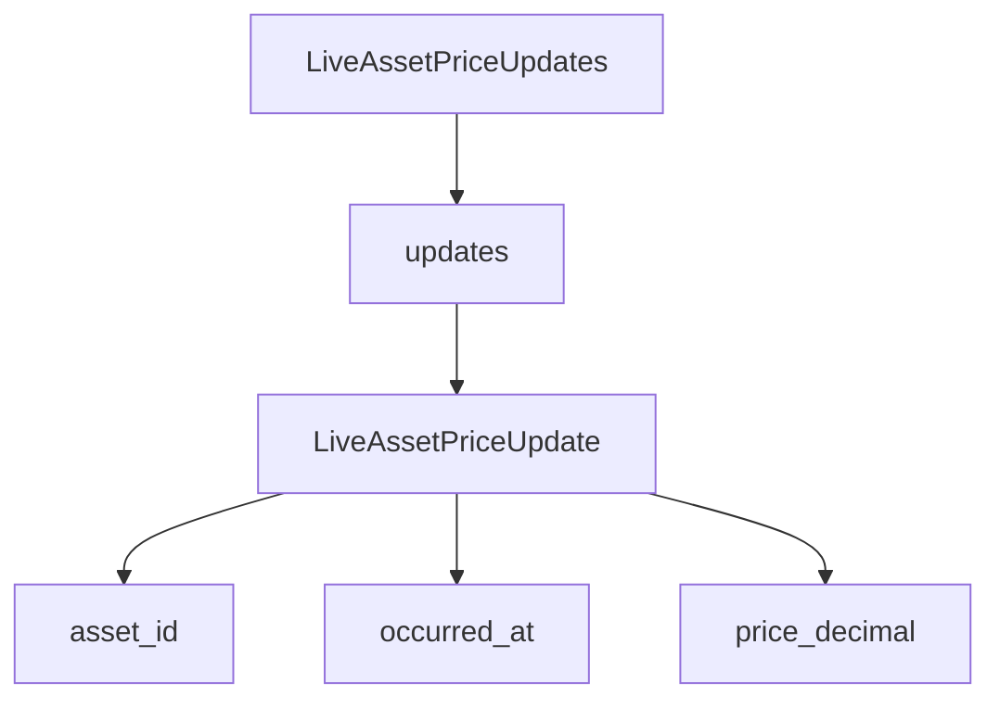

# iOS Live Asset Price Batch Spec

Related plan: [[ios-live-asset-update-batch-todo]]

Status: Awaiting revised approval

## Problem

The current response models one typed asset update. The stream must send a batch of price updates in each response.

## Goal

Change `LiveAssetUpdates` to stream `LiveAssetPriceUpdates` messages. Each message contains repeated `LiveAssetPriceUpdate` values.

## Assumptions

- The RPC name remains `LiveAssetUpdates`.
- The request remains `LiveAssetUpdatesRequest`.
- Each item contains its own asset identifier and update time.
- `price_decimal` is a direct field on each item.
- Checked-in Go, TypeScript, and Python bindings must match the proto.

> [!warning]
> This change replaces the response type. Producers and consumers must update together.

## Data Flow

## Message Shape

## Field Mapping

| Output field | Source |
|---|---|
| `LiveAssetPriceUpdates.updates = 1` | Repeated price update values |
| `LiveAssetPriceUpdate.asset_id = 1` | Existing asset identifier |
| `LiveAssetPriceUpdate.occurred_at = 2` | Existing RFC3339 UTC update time |
| `LiveAssetPriceUpdate.price_decimal = 3` | Existing base-10 price string |

## Expected Behavior

- Each stream response contains zero or more price updates.
- Each price update identifies one asset.
- Each price update contains its own RFC3339 UTC time.
- Each price update contains one base-10 price string.
- The request message does not change.

## Inputs and Outputs

| Item | Value |
|---|---|
| Input | `LiveAssetUpdatesRequest` |
| Stream output | `LiveAssetPriceUpdates` |
| Batch entries | Repeated `LiveAssetPriceUpdate` values |

## Edge Cases

> [!note]
> Protobuf permits an empty `updates` list. Server validation is outside this schema task.

> [!note]
> Protobuf cannot enforce a non-empty decimal string. Server validation is outside this schema task.

## Compatibility

- Remove `LiveAssetUpdate`.
- Remove `AssetUpdate`.
- Remove `AssetPriceUpdate`.
- Change the RPC response type.
- Regenerate all checked-in bindings for this proto.

## Verification

- Compile `hypurr/ios.proto` with the installed protobuf compiler.
- Regenerate checked-in Go, TypeScript, and Python bindings.
- Run `go test ./...`.
- Run `go build ./...`.
- Run the available TypeScript check if the project defines one.
- Import the generated Python module.
- Run `git diff --check`.

## Out of Scope

- Server implementation changes
- Client application changes
- Request filters
- Batch size limits
- Other stream messages
