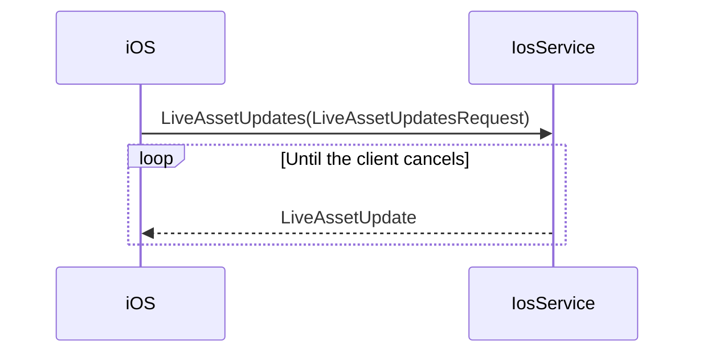

# iOS Live Asset Updates Proto Spec

Related plan: [[ios-live-asset-updates-proto-todo]]

Source: [hypurr-grpc issue 18](https://github.com/Hypurr-Fun/hypurr-grpc/issues/18)

Status: Awaiting approval

## Goal

Add the `IosService.LiveAssetUpdates` contract to `hypurr/ios.proto`.

Keep the service methods and message sections in the same order.

## Contract Flow

## Service Mapping

| Service item | Contract |
|---|---|
| RPC | `LiveAssetUpdates(LiveAssetUpdatesRequest) returns (stream LiveAssetUpdate)` |
| Request | Empty `LiveAssetUpdatesRequest` |
| Response | One `LiveAssetUpdate` for each asset price update |

> [!info]
> Place the RPC after `Home`. Place its message section after the Home section.

## Field Mapping

| Output field | Source |
|---|---|
| `LiveAssetUpdate.asset_id = 1` | Stable Hyperliquid or backend asset ID |
| `LiveAssetUpdate.occurred_at = 2` | RFC3339 UTC update time |
| `LiveAssetUpdate.price = 10` | Price variant in the `update` oneof |
| `AssetPriceUpdate.price_decimal = 1` | Required base-10 price string from the asset update |

> [!note]
> The first `update` oneof contains only `price`. Add no placeholder variants.

> [!warning]
> Keep `AssetDetailLiveUpdates`. Issue 18 only replaces Home's prior live-price stream.

## Expected Behavior

- The request has no fields.
- The server streams asset updates until the client cancels.
- Each event identifies one asset.
- Each event has an RFC3339 UTC time.
- Each event contains one concrete update variant.
- The first contract supports only price updates.

## Edge Cases

> [!note]
> Protobuf permits an unset `update` oneof. Server validation is outside this proto-only task.

> [!note]
> The proto cannot enforce a non-empty decimal string. Server validation is outside this task.

## Compatibility

This change adds one RPC and three messages. It does not change existing field numbers or signatures.

## Verification

- Format `hypurr/ios.proto` with the repository toolchain if a formatter exists.
- Compile `hypurr/ios.proto` to a temporary descriptor.
- Run `go test ./...`.
- Run `go build ./...`.
- Run `git diff --check`.
- Quote the relevant command output before completion.

## Out of Scope

- Generated Go, TypeScript, and Python files
- Server implementation
- iOS application changes
- Removal or changes of `AssetDetailLiveUpdates`
- Additional update variants
- Request filters
