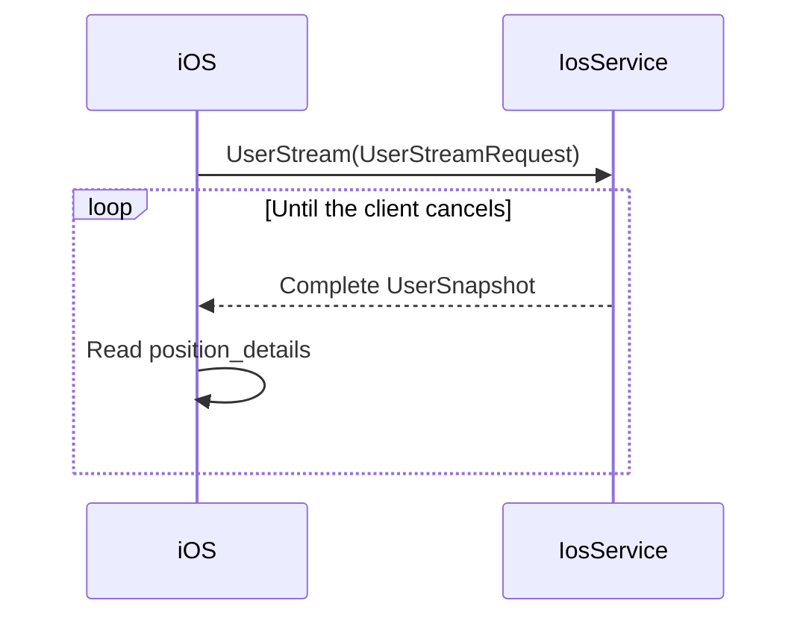
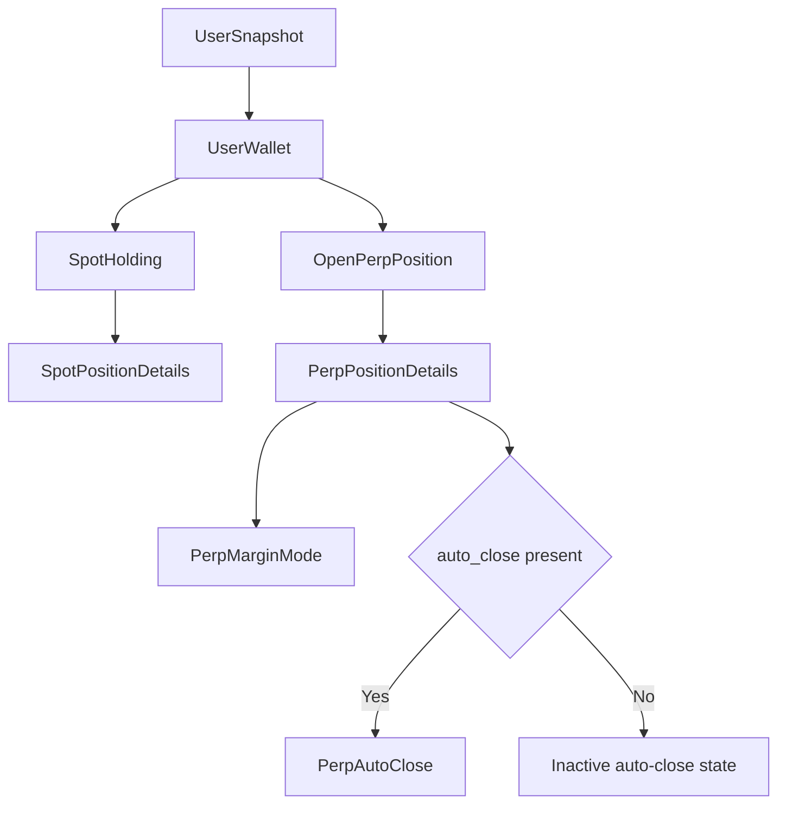

# iOS User Stream Position Details Spec

Related plan: [[ios-user-stream-position-details-todo]]

Source: [GitLab work item 19 note](https://gitlab.com/hypurr/hypurr-grpc/-/work_items/19#note_3763192550)

Status: Awaiting approval

## Problem

`UserSnapshot` contains current spot and perpetual positions. These positions do not contain all Position Details values.

## Goal

Add the Position Details values to each current position in the existing `UserStream` snapshot.

## Decisions

> [!info]
> Keep the existing `UserStream` RPC and snapshot structure. Do not add an RPC.

> [!info]
> Use the field names, numbers, types, and presence rules from the GitLab note.

> [!warning]
> `margin_mode` has no `UNSPECIFIED` value. The backend must emit `ISOLATED` or `CROSS`.

> [!warning]
> The backend must define one meaning for `margin_cents` across both margin modes.

## Data Flow

## Message Shape

## Field Mapping

| Output field | Source |
|---|---|
| `SpotHolding.position_details = 5` | Current spot Position Details values |
| `OpenPerpPosition.position_details = 9` | Current perpetual Position Details values |
| `SpotPositionDetails.unrealized_pnl_cents = 1` | Signed unrealized profit or loss |
| `SpotPositionDetails.average_cost_price_decimal = 2` | Average spot cost price |
| `SpotPositionDetails.roe_percent = 3` | Signed spot return on equity |
| `SpotPositionDetails.portfolio_share_percent = 4` | Share of portfolio value |
| `PerpPositionDetails.funding_cents = 1` | Signed net funding value |
| `PerpPositionDetails.mark_price_decimal = 2` | Current mark price |
| `PerpPositionDetails.entry_price_decimal = 3` | Position entry price |
| `PerpPositionDetails.liquidation_price_decimal = 4` | Position liquidation price |
| `PerpPositionDetails.size_decimal = 5` | Base-asset quantity |
| `PerpPositionDetails.notional_value_cents = 6` | Current USD notional value |
| `PerpPositionDetails.margin_cents = 7` | Backend-defined position margin |
| `PerpPositionDetails.margin_mode = 8` | Isolated or cross margin mode |
| `PerpPositionDetails.auto_close = 9` | Active auto-close configuration |
| `PerpAutoClose.take_profit_price_decimal = 1` | Take-profit price |
| `PerpAutoClose.stop_loss_price_decimal = 2` | Stop-loss price |

## Enum Mapping

| Value | Number |
|---|---|
| `PERP_MARGIN_MODE_ISOLATED` | `0` |
| `PERP_MARGIN_MODE_CROSS` | `1` |

## Expected Behavior

- Each current spot holding contains `position_details`.
- Each current perpetual position contains `position_details`.
- Each perpetual detail contains a valid `margin_mode`.
- Present `auto_close` data means that auto-close is active.
- Absent `auto_close` data means that auto-close is inactive.
- Mobile code owns numeric formatting and localized labels.

## Edge Cases

> [!note]
> Proto3 cannot require message presence. The backend must populate both `position_details` fields.

> [!note]
> Proto3 uses `ISOLATED` as the default enum value because it has number `0`.

> [!note]
> Decimal strings can be empty at the schema level. Backend validation is outside this task.

## Compatibility

The change adds new fields, messages, and an enum. It does not change existing field numbers or RPC signatures.

## Generated Outputs

| Language | Files |
|---|---|
| Go | `go/hypurr/ios.pb.go` |
| TypeScript | `ts/hypurr/ios.ts` |
| Python | `python/hypurr/ios_pb2.py` |

> [!note]
> The gRPC companion files should not change because the RPC signature stays the same.

## Verification

- Compile `hypurr/ios.proto` with each configured generator.
- Run `go test ./...`.
- Run `go build ./...`.
- Run `go vet ./...`.
- Import the generated Python modules.
- Run the available TypeScript check if the project defines one.
- Run `git diff --check`.

## Out of Scope

- Backend implementation
- Mobile implementation
- A new Position Details RPC
- Changes to existing field numbers
- Backend definition of `margin_cents`
- Numeric or localized display formatting
