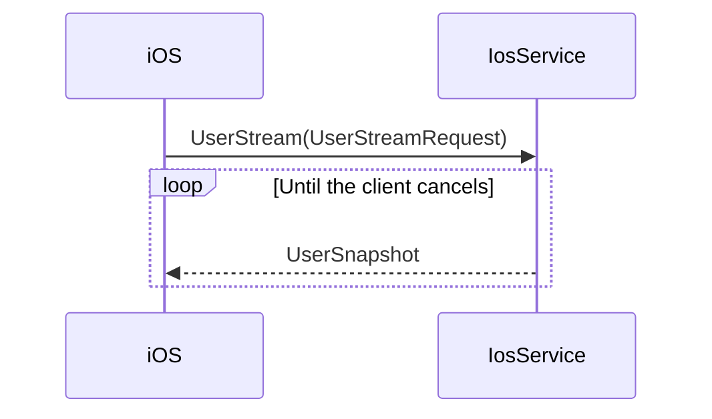

# iOS User Stream Proto Spec

Related plan: [[ios-user-stream-proto-todo]]

Source: [hypurr-grpc issue 17](https://github.com/Hypurr-Fun/hypurr-grpc/issues/17)

Status: Awaiting approval

## Goal

Add the `IosService.UserStream` contract to `hypurr/ios.proto`.

Regenerate the checked-in Go, TypeScript, and Python clients from this contract.

## Contract Flow

## Service Mapping

| Service item | Contract |
|---|---|
| RPC | `UserStream(UserStreamRequest) returns (stream UserSnapshot)` |
| Request | Empty `UserStreamRequest` |
| Response | Complete `UserSnapshot` |

## Message Mapping

| Message | Fields |
|---|---|
| `WalletReference` | `wallet_id = 1`, `name = 2` |
| `UserSnapshot` | `as_of = 1`, `all_wallets_value = 2`, `wallets = 3` |
| `UserWallet` | `wallet = 1`, `value = 2`, `spot_holdings = 3`, `perp_positions = 4` |
| `PortfolioValue` | `total_balance_cents = 1`, `change_cents = 2`, `change_percentage = 3` |
| `SpotHolding` | `asset = 1`, `quantity_decimal = 2`, `market_value_cents = 3` |
| `OpenPerpPosition` | `position_id = 1`, `asset = 2`, `leverage = 3`, `side = 4` |
| `OpenPerpPosition` | `unrealized_pnl_cents = 5`, `roe_percent = 6`, `liquidation_warning = 7` |
| `PerpLiquidationWarning` | `distance_percentage = 1` |
| `PerpSide` | `PERP_SIDE_LONG = 0`, `PERP_SIDE_SHORT = 1` |

Use the comments and field numbers from the issue contract.

> [!info]
> `WalletReference` does not exist in the current proto. Add the minimum fields shown in the issue example.

> [!warning]
> Do not change existing field numbers, RPC signatures, or message fields.

## Generated Outputs

| Language | Files |
|---|---|
| Go | `go/hypurr/ios.pb.go`, `go/hypurr/ios_grpc.pb.go` |
| TypeScript | `ts/hypurr/ios.ts`, `ts/hypurr/ios.client.ts` |
| Python | `python/hypurr/ios_pb2.py`, `python/hypurr/ios_pb2_grpc.py` |

Run targeted generators for `hypurr/ios.proto`. Do not regenerate unrelated proto files.

## Verification

- Compile `hypurr/ios.proto` with each configured generator.
- Run `go test ./...`.
- Run `go build ./...`.
- Run `go vet ./...`.
- Import the generated Python modules.
- Type-check the generated TypeScript files if the repository supports it.
- Run `git diff --check`.

## Out of Scope

- Server implementation
- iOS application changes
- Changes to existing iOS RPCs
- Additional wallet fields
- Pagination or request filters
